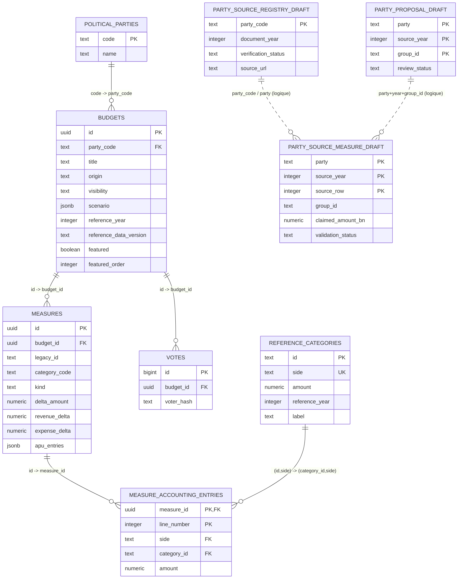

# Schéma de données Neon — état réel au 20 novembre 2026

**Document de référence technique.** Établi à partir de l'introspection de la base Neon de production du projet `calm-rain-58562193`, et rapproché du code `main`. Les migrations SQL versionnées expliquent les changements ; `db/schema.sql` est un **bootstrap historique**, pas un dump exact de production ni un outil de mise à niveau à rejouer tel quel.

## Périmètres et statuts

- **Actif** : schéma, contraintes et écritures politiques déjà exploités par `api/reference.ts` et le moteur V1.
- **Préparation** : tables suffixées `_draft`, non exposées par l'API et **non prises en compte** dans le déficit.
- **Historique** : snapshots `*_backup_*`, `*_before_*` et `*_snapshot_*` pour restauration ; ne pas supprimer avant recette finale.
- **Source de vérité comptable des mesures politiques actives** : `measure_accounting_entries`, jamais `title`, `theme`, `budgets.title` ni `legacy_id`.
- **Source de vérité des montants de référence** : `reference_categories` et `reference_off_budget`, pas la copie de repli dans `src/data.ts`.

## Diagramme relationnel



Les relations en pointillés représentent des **rattachements logiques non encore matérialisés par des clés étrangères** dans les tables de préparation. Le diagramme ne doit pas laisser croire que les 25 groupes sont intégrés à `measures` ou au calcul public.

## Nouvelles tables relationnelles permanentes (créées en base le 20/11/2026)

La transition documentaire a franchi une étape **sans activation de nouveaux budgets** :

- `party_proposals` : PK composite `(party_code,source_year,group_id)`, FK `party_code` → `political_parties.code`. Titre d'affichage, `source_measure_count`, `review_status` limité à `review_pending`, `validated` ou `rejected`.
- `party_source_lines` : PK composite `(party_code,source_year,source_row)`, FK composite **validée** `(party_code,source_year,group_id)` → `party_proposals`. Sens de flux contrôlé, montant revendiqué positif ou nul, source HTTPS, statut documentaire et éventuel tag APU manuel.
- Index `idx_party_source_lines_group(party_code,source_year,group_id,source_row)` pour les lectures d'un groupe.
- Initialisation RN → `RN`, LFI → `LFI`, Équinoxe → `EQX` : correspondances **explicites de codes**, aucun libellé parsé comme clé. Vérifié : 25 groupes, 232 lignes, **zéro orpheline**, décomptes par groupe cohérents, **zéro groupe validé**.
- Les tables `party_proposal_draft` et `party_source_measure_draft` sont conservées provisoirement comme données d'origine, **pas comme second moteur comptable**. La promotion vers les nouvelles tables n'implique pas leur publication.

Le modèle cible est désormais :

```text
political_parties.code
  ├── budgets.party_code → measures.id → measure_accounting_entries
  └── party_proposals (party_code, source_year, group_id)
        └── party_source_lines (party_code, source_year, source_row)
```

**Raccordement encore manquant :** rattacher les mesures comptables validées aux lignes sources et aux groupes par des clés stables et des contraintes d'unicité. Ne pas supposer que ce lien existe déjà dans le schéma ; aucun groupe préparatoire ne doit être compté automatiquement.

Migration reproductible : [`db/migrations/20261120_party_proposals_relational.sql`](../db/migrations/20261120_party_proposals_relational.sql).

Modèle de contribution synchronisé : [PR programme politique](../.github/PULL_REQUEST_TEMPLATE/political-programme.md) et [issue de soumission](../.github/ISSUE_TEMPLATE/political-programme.yml). Ils exigent désormais identifiants stables, validation APU, contrôle des doublons et mise à jour du schéma.

## Tables opérationnelles

| Table | Identité et contenu | Intégrité / comportement |
| --- | --- | --- |
| `political_parties` | `code TEXT PK`, `name TEXT NOT NULL` | 13 formations initialisées. Le code est stable ; nom uniquement pour affichage |
| `budgets` | `id UUID PK`, `party_code TEXT NULL`, `origin`, `visibility`, `scenario JSONB`, millésime, champs `featured` | FK `party_code` → `political_parties.code` **validée** ; `origin='party'` exige un code ; budget citoyen sans parti. Les titres ne servent pas au rattachement |
| `measures` | `id UUID PK`, `budget_id UUID FK`, `legacy_id`, `category_code`, `kind`, `delta_amount`, `reference_amount`, `revenue_delta`, `expense_delta`, `status`, `source`, `apu_entries JSONB` | Référence commune citoyen/parti ; unicité partielle `(budget_id,legacy_id)`. `apu_entries` = **copie transitoire à retirer après recette**, pas la source utilisée par l'API |
| `measure_accounting_entries` | `(measure_id,line_number) PK`, `side`, `category_id`, `amount NUMERIC` | FK mesure `ON DELETE CASCADE` et FK composite `(category_id,side)` → `reference_categories(id,side)`, **validées** ; `side IN ('revenues','expenses')`, `line_number>0` |
| `reference_categories` | `id TEXT PK`, `side`, `label`, `amount`, `canonical`, `description`, `reference_year`, `sort_order` | 15 catégories dépenses et 10 recettes, **y compris « Autres et ajustement »**, à conserver. Unicité additionnelle `(id,side)` pour la FK d'écritures |
| `reference_off_budget` | Deux avantages fiscaux/sociaux de référence, `revenue_impact_category` | Hors agrégats APU : seule la variation du manque à gagner impacte les recettes |
| `votes` | `id BIGINT PK`, `budget_id UUID FK`, `voter_hash` | Unicité `(budget_id,voter_hash)` ; ne prouve pas l'identité unique d'une personne |
| `publication_limits` | Empreinte et date de publication | Contrôle anti-abus par fonction SQL `publish_citizen_budget` |

### Référence 2025 active

- Recettes APU : **1 561,7 Md€** ; dépenses : **1 714,2 Md€** ; déficit : **152,5 Md€**.
- Ventilations individuelles : approximations/reconstitutions assumées, **pas** certification INSEE de chaque catégorie.
- Postes « Autres recettes et ajustement » : **0 Md€** ; « Autres dépenses et ajustement » : **0,8 Md€** ; restent dans le moteur et l'interface après migration.
- Les propositions politiques 2026 chiffrées par rapport au PLF/PLFSS 2026 ne deviennent pas automatiquement des effets économiques certifiés sur la référence APU 2025.

### Structures de préparation, non publiques

| Table | Clé | Contenu / statut |
| --- | --- | --- |
| `party_source_registry_draft` | `party_code` | 13 formations recensées et statut de recherche/validation de source |
| `party_source_measure_draft` | `(party,source_year,source_row)` | 232 lignes : RN 75, LFI 143 préliminaires, Équinoxe 14 grandes lignes préliminaires ; revendications, sens, URL, tag manuel éventuel |
| `party_proposal_draft` | `(party,source_year,group_id)` | 25 regroupements : RN 9, LFI 8, Équinoxe 8 ; **`review_pending`** |
| Fichiers GitHub `data/programmes/` | Identifiants documentaires et liens sources | Inventaires et rapprochements publiquement consultables dans « Notre méthode » |

**Attention :** le groupe de présentation n'est **pas** une écriture comptable ; seules les composantes validées produisent un effet. Les propositions partielles doivent rester identifiées comme telles. Le tag `non_chiffrable_apu` est une décision **manuelle** applicable aux propositions des partis ; il ne constitue ni une économie à zéro ni une inférence du RAG. Le RAG est une architecture générique, utilisée pour les sources des partis en V1, non pour chiffrer automatiquement les effets.

## Chaîne d'exécution et contrats

```text
Neon / reference_categories, reference_off_budget
    + budgets / party_code -> political_parties.code
    + measures -> measure_accounting_entries
                  ↓
GET /api/reference : catégories, mesures 'publié' de partis visibles,
                     code stable, apuEntries dérivées des lignes SQL,
                     contrôle sommes des écritures = deltas annoncés
GET /api/budgets   : scénarios citoyens et politiques visibles + party_code + votes
                  ↓
React / src/App.tsx : collections de catégories et mesures, scénarios
                  ↓
AccountingService -> calculateScenario / projectMeasure
                  ↓
SimulationService -> AssessmentService -> vues
```

- Le moteur privilégie `Measure.apuEntries` reçues par API ; il vérifie catégories, sens, finitude et réconciliation avec `revenueDelta`/`expenseDelta`. Une mesure documentaire incohérente fait **échouer** la projection ; pas de solde partiel silencieux. Le repli sur `rules` reste présent **uniquement pour les mesures historiques/fixtures** et doit disparaître après migrations et tests.
- `calculateScenario(ids, overrides, sourcedEntries?)` garde son contrat historique ; troisième argument facultatif. `src/engine/documented-budget.ts` et `party-proposals.ts` sont des adaptateurs pour les groupes ; **pas encore appelés par le parcours public**.
- `GET /api/reference` ne lit **pas** les tables `_draft`. L'API fait aussi un contrôle de somme avant réponse : si elle détecte une incohérence, elle retourne une indisponibilité plutôt que des données invalides.
- `GET /api/budgets` expose `party_code` sans analyser le titre. L'écran possède encore une sélection de parti initiale et un chemin d'activation historiques ; **l'activation automatique des nouveaux partis/groupes reste à terminer**.
- L'exclusion de mesures non chiffrables doit être portée dans le modèle avant toute promotion des tables `_draft`. Le critère « source publiée » ne signifie pas « impact APU validé ».

## Index opérationnels vérifiés

- `budgets_pkey(id)` et index partiels `idx_budgets_public(published_at DESC)`, `idx_budgets_featured(featured_order,published_at DESC)`, `idx_budgets_public_party_code(party_code,featured_order)` pour partis visibles ;
- `idx_measures_budget_legacy(budget_id,legacy_id)` unique partiel ;
- `measure_accounting_entries_pkey(measure_id,line_number)` ;
- `votes_budget_id_voter_hash_key(budget_id,voter_hash)` unique, et `idx_votes_budget(budget_id)` ;
- `party_source_measure_draft_pkey(party,source_year,source_row)` et `idx_party_source_measure_group(party,source_year,group_id,source_row)`.

Mesures ponctuelles `EXPLAIN (ANALYZE,BUFFERS)` : lectures de budgets/mesures publiées ~0,1 ms côté PostgreSQL avec **seulement quelques enregistrements** ; accès à un groupe RN ~0,08 ms. Ces chiffres **n'incluent pas le réseau, la durée des fonctions Vercel ni la latence réelle de l'API** et ne sont pas une garantie à charge future.

## Migrations, non-régression, nettoyage

1. Bootstrap historique : [`db/schema.sql`](../db/schema.sql). Ne pas l'exécuter sur une production existante ; il contient des DDL et des `INSERT/UPDATE` de référence historiques.
2. Préparation : [`db/migrations/20261120_party_documentary_groups.sql`](../db/migrations/20261120_party_documentary_groups.sql).
3. Identification stable et écritures : [`db/migrations/20261120_party_ids_apu_entries.sql`](../db/migrations/20261120_party_ids_apu_entries.sql). **Script de traçabilité, non intégralement idempotent**, et import initial des montants documenté mais non automatisé dans ce fichier.
4. Index : [`db/migrations/20261120_api_indexes.sql`](../db/migrations/20261120_api_indexes.sql).
5. Audit de cohérence : [`db/audits/party-source-grouping-readonly.sql`](../db/audits/party-source-grouping-readonly.sql).
6. CI : [`.github/workflows/ci.yml`](../.github/workflows/ci.yml) — `npm run check`, `npm test`, `npm run build` à chaque push sur `main` et chaque PR. Vérifier le résultat de la **dernière** exécution avant bascule.
7. Après validation de production et test de restauration : nettoyer les snapshots temporaires, pas les inventaires sources. Les historiques contenant empreintes ou votes ne doivent **jamais** être exportés publiquement sur GitHub.

## Points restant à traiter dans le modèle

- **Partiellement réalisé** : \`party_proposals\` et \`party_source_lines\` ont maintenant des FK réelles. Il reste à lier explicitement les écritures comptables actives aux lignes sources des propositions validées.
- Éliminer la double représentation transitoire `measures.apu_entries` et `measure_accounting_entries` après recette, en conservant **uniquement la table normalisée**.
- Refuser explicitement les mesures politiques actives sans écritures validées, et vérifier qu'une source documentaire ne contribue qu'à un seul calcul.
- Remplacer les reliquats de règles V1 et fixtures codées en dur ; garder les mêmes modèles, calculs et 25 catégories pour les citoyens et les partis.
- Vérifier la protection de branche GitHub et le déploiement Vercel indépendamment du succès de la CI.

Pour le suivi, consulter [l'issue #59](https://github.com/dsissoko/france-budget/issues/59).
