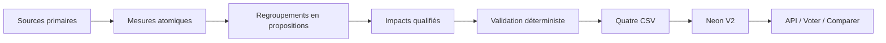

# Pipeline V2 — extraction, regroupement, qualification et import

## Principe d'architecture

Le skill [budget-impact-qualification](../skills/budget-impact-qualification/SKILL.md) intervient dans les phases d'analyse qui requièrent une interprétation : **extraction des mesures** à partir des sources primaires, **regroupement en propositions** et **qualification des impacts** sur le budget citoyen. Toutes les validations structurales, numériques et l'import dans Neon restent **déterministes** ; aucun agent n'est exécuté lors d'une requête de l'UI ou par le moteur.

| Étape | Responsable | Entrées | Résultats |
|---|---|---|---|
| 1. Acquisition des sources | Opérateur / skill | PDF, URL, millésime | Sources datées et vérifiables |
| 2. Extraction des mesures | Skill agentique | Sources primaires | `measures.csv` : engagements atomiques, provenance, chiffrage éventuel |
| 3. Regroupement | Skill agentique + contrôle mécanique | Mesures et postes de référence | `proposals.csv` et `measure_key → proposal_key` |
| 4. Qualification des impacts | Skill agentique et revue métier | Groupes, montants, pivot 27 postes | `impacts.csv` justifié et registre d'arbitrage |
| 5. Validation | Programme déterministe | Les quatre CSV | Clés, cardinalités, unités, sources, exclusivité, sommes |
| 6. Import | `scripts/v2/import.mjs` / `v2.import_budget` | CSV approuvés | Transaction, identifiants stables et contrôle d'idempotence |
| 7. Calcul et affichage | API / moteur / React | Modèle V2 | Budgets, propositions et mesures consultables sans calcul agentique |

## Modèle canonique

- **Mesure :** engagement élémentaire extrait du programme, porteur de `measure_key`, provenance et `claimed_amount_bn` éventuel. Une mesure ne produit pas directement un impact.
- **Proposition :** regroupement de zéro à N mesures par `proposal_key`. Zéro mesure signifie une proposition citoyenne créée directement ; pour les programmes politiques, les mesures sont rattachées aux propositions.
- **Impact :** `budget_key,proposal_key,side,category_id,delta_amount_bn` ; une et une seule variation comptable par `(budget_key,side,category_id)`.

Le calcul n'infère pas de chiffre à partir de l'intitulé. Un programme `PARTIAL` applique les seuls impacts qualifiés ; en `AGGREGATE`, les masses revendiquées restent la référence et les ventilations documentaires n'y sont jamais ajoutées.

## Regroupements et exclusivité

Construire un graphe biparti des mesures et des postes auxquels elles pourraient contribuer. Une composante connexe forme une proposition : lorsque deux mesures touchent le même poste, elles appartiennent à la même proposition. Lorsque l'une touche plusieurs postes, le regroupement est transitif. Les mesures sans poste suffisamment justifié restent documentaires mais ne disparaissent jamais.

Chaque impact appartient à une proposition, qui conserve ses mesures sources. Le contrôle déterministe exige des `measure_key` uniques par budget, un `proposal_key` valide pour chaque mesure, une source traçable, un montant signé et un poste existant pour chaque impact. La contrainte SQL `UNIQUE(budget_id,side,category_id)` interdit les doubles imputations.

## Recette de référence

- **LFI 2027 :** 28 mesures extraites → 11 propositions consolidées, dont Éducation regroupant `src-19`, `src-20` et `src-21`. L'impact qualifié Éducation vaut +4,000 Md€ et provient seulement des montants qualifiés `src-19` et `src-21`; la mesure `src-20` reste documentaire. Les masses annoncées +106,4 Md€ recettes et +81,7 Md€ dépenses (solde +24,7 Md€) ne changent pas.
- **NoPasaran :** 0 mesure extraite, 8 propositions directement citoyennes, 8 impacts validés ; défense −25 Md€ sur une seule ligne.
- **RN 2026 :** 78 mesures, 78 propositions sans impact activé non justifié.

## Exploitation

La création canonique se fait via `npm run db:init` sur base vierge puis `npm run db:import`, et non par l'empilement de migrations V1/V2. Exécuter `npm run test:v2`, `npm run check`, `npm run docs:check` et `npm run db:check -- --live` sur QA ; vérifier la parité source → proposition → impact → API → UI. Les bases existantes doivent être explicitement ciblées avant toute remise à zéro ; les anciens votes et contributions ne sont pas repris lors de la reconstruction V2 décidée dans #154.
