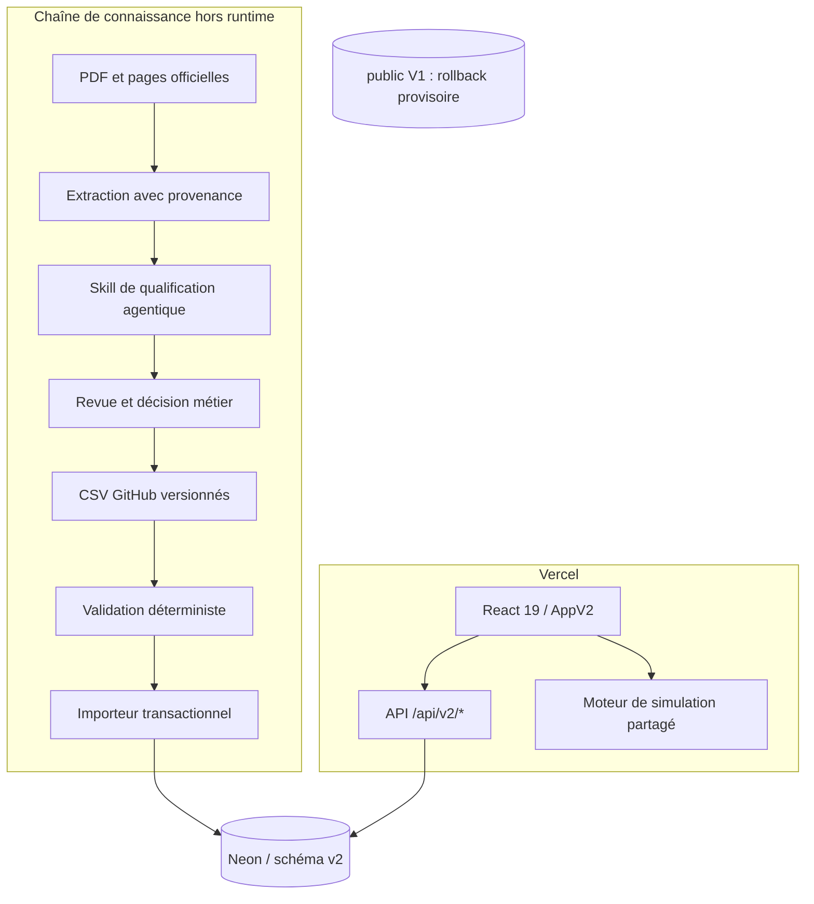

# Architecture technique V2

## Flux applicatif et ingestion

**Aucun agent dans le chemin d'exécution d'une requête API ou d'une simulation.** Les CSV et les décisions qualifiées précèdent l'import.

## Composants vérifiables

| Domaine | Implémentation |
|---|---|
| UI | [src/AppV2.tsx](../../src/AppV2.tsx), [src/main.tsx](../../src/main.tsx) |
| Backend | [api/v2](../../api/v2/) |
| Accès DB | [api/v2/_db.ts](../../api/v2/_db.ts), variable serveur `V2_DATABASE_URL` |
| Données SQL | [db/v2](../../db/v2/) |
| Import | [scripts/v2/import.mjs](../../scripts/v2/import.mjs) |
| Qualification | [skill V2](../../skills/budget-impact-qualification/SKILL.md) |
| Simulation | [projection-core](../../src/projection-core.ts) et moteur partagé |

## Frontières de sécurité

- Ne jamais exposer `V2_DATABASE_URL` sous un préfixe `VITE_`.
- Les opérations d'import ne sont **pas** accessibles au public ; distinguer le rôle d'import du rôle applicatif.
- Un schéma PostgreSQL distinct n'isole pas les permissions : le rôle d'application V2 doit être limité au schéma `v2`.
- La V1 reste conservée pendant la fenêtre de rollback, sans devenir un fallback runtime de V2.
- Les mutations citoyennes sont contrôlées au serveur (origine, validation, révision, jeton, quota).
