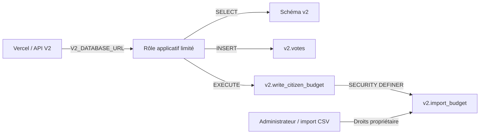
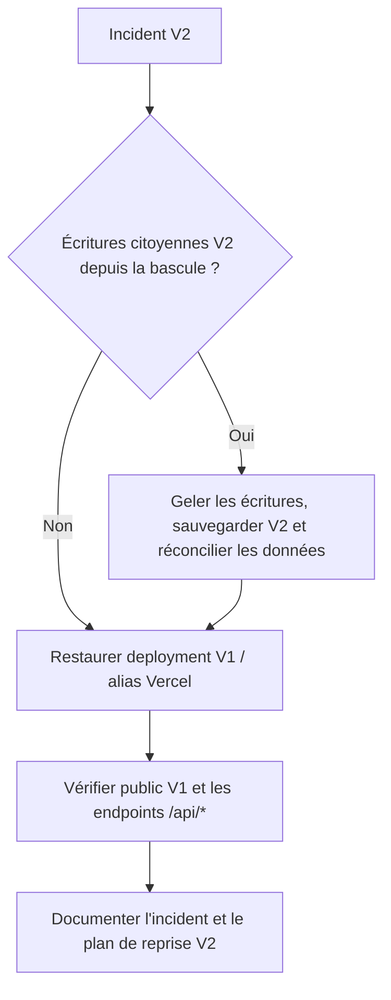

# Exploitation — V2 et reconstruction canonique #154

> **État au 22 novembre 2026 :** application V2 déployée depuis `main` (commit `bd8452a`) sur Vercel ; API `/api/v2/*`, stockage Neon PostgreSQL dans le schéma `v2`. Le schéma historique `public` est conservé pour retour arrière et n'est pas l'autorité des nouvelles données.

## Inventaire historique de production (22 novembre 2026)

| Élément | Après import |
| --- | ---: |
| Postes de référence 2025 | 27 |
| Budgets initiaux publiés | 16 |
| Propositions stockées | 288 |
| Impacts canoniques V2 | 13 |
| Votes initiaux | 0 |
| NoPasaran | 8 propositions / 8 impacts |
| LFI 2027 | 28 mesures sources, 11 groupes, 15 postes, 11 allocations internes |
| Allocations LFI / reliquats | Recettes 84,4 / 22 Md€ ; dépenses 37,7 / 44 Md€ |

Les budgets citoyens et votes V1 étaient des tests jetables : ils n'ont pas été migrés. **Décision #154 :** la nouvelle V2 est reconstruite à partir des CSV, sans conservation obligatoire des anciennes contributions ni des votes. Ces derniers ne sont pas recréés par le contrat CSV. La remise à zéro doit être explicitement ciblée, jamais déclenchée par un import normal. Les agrégats LFI annoncés (recettes +106,4 Md€, dépenses +81,7 Md€) donnent une variation de solde +24,7 Md€, les allocations ne les majorent pas.

La branche Neon `backup-pre-v2-cutover-20261122` constitue une sauvegarde de l'état V1 avant les changements. Restaurer cette branche **n'est pas** un rollback sans perte des données V2 plus récentes.

## Installation autonome — environnement neuf

La source de vérité de référence est `data/reference/2025-v2.json` ; les budgets initiaux viennent des CSV sous `data/programmes/<formation>/<année>`.

```bash
npm install
npm run check
npm test
npm run test:v2
npm run docs:check
npm run build

# Aucun SQL par défaut ; valide la fixture
npm run db:init

# Sur une base de recette vide, avec PostgreSQL psql disponible :
# export V2_DATABASE_URL='postgresql://...'
# export V2_APP_ROLE='role_applicatif_existant' # facultatif
npm run db:init -- --apply --confirm-empty-v2

# Si la V2 cible est déjà peuplée ET si sa perte est explicitement décidée :
# npm run db:init -- --apply --force --confirm-reset-v2

# Audit des CSV puis import transactionnel
npm run db:import
npm run db:import -- --apply
npm run db:check -- --live
```

`db:init` refuse par défaut l'initialisation si `v2.budgets` contient déjà des données. **L'option destructive `--force` nécessite `--apply --confirm-reset-v2`** : elle supprime et recrée le schéma `v2` dans une transaction, puis réinstalle tous ses objets et la référence. Vérifier au préalable `V2_DATABASE_URL` (base et branche Neon), la fenêtre de bascule et les dépendances SQL externes éventuelles (`CASCADE`) ; les anciennes contributions et les votes sont perdus. Ensuite seulement, exécuter `npm run db:import -- --apply` et `npm run db:check -- --live`. Le merge GitHub ne lance jamais cette commande. Les écritures de `db:import` sont idempotentes par budget, mais la revue des CSV et l'environnement cible restent obligatoires.

Les scripts de création inclus dans le bootstrap sont `001_schema.sql`, `003_citizen_crud.sql`, `004_votes.sql`, `initial_ui.sql`, `007_citizen_featured.sql` et `006_runtime_permissions.sql`. Les migrations historiques `002_seed_reference.sql` et `005_ui_contract.sql`, dépendantes de `public`, sont **obsolètes pour de nouvelles installations** et restent archivées le temps de sécuriser le rollback.

**Preuve de reproductibilité (Neon QA, 22 novembre 2026) :** sur la base vierge `v2_bootstrap_check_20261122`, les scripts SQL de création et le référentiel versionné ont créé exactement 27 postes, sans table `public.budgets`. NoPasaran a été importé deux fois : même UUID, 1 budget, 8 propositions et 8 impacts, aucun doublon. Cette validation ne remplace pas la vérification des permissions du rôle applicatif sur chaque environnement.

## Privilèges PostgreSQL



- Le rôle de Vercel possède `USAGE` sur `v2`, les lectures nécessaires, l'insertion des votes et `EXECUTE` sur la fonction de gestion citoyenne.
- `v2.write_citizen_budget` est `SECURITY DEFINER` avec `search_path=v2,pg_temp`, puis vérifie jeton et révision.
- L'exécution directe de `v2.import_budget` est refusée au rôle applicatif. Le `PUBLIC EXECUTE` des fonctions est révoqué.
- `db/v2/006_runtime_permissions.sql` versionne ces droits. Avec `SET LOCAL v2.application_role` ou `V2_APP_ROLE`, la migration octroie les permissions minimales à un rôle déjà existant ; ne pas intégrer de mot de passe dans le dépôt.
- `V2_DATABASE_URL` est une variable Vercel côté serveur, distincte de `DATABASE_URL` (V1), même si elles se connectent au même cluster et à la même base.

Une erreur `permission denied for schema v2` a été observée au tout premier démarrage du déploiement. Les droits ont été corrigés et validés par requêtes PostgreSQL. Le contrôle HTTP direct du service exposé doit être consigné séparément ; **le statut READY Vercel et la vérification SQL ne remplacent pas un test HTTP**.

## Contrôles post-déploiement

```bash
export BASE_URL=https://mon-budget-citoyen.vercel.app
curl -fsS "$BASE_URL/api/v2/reference"
curl -fsS "$BASE_URL/api/v2/budgets?origin=party"
curl -fsS "$BASE_URL/api/v2/budgets/nopasaran-2025"
curl -fsS "$BASE_URL/api/v2/budgets/lfi-2027/positions"
```

Vérifier : 27 postes, 16 budgets, 279 mesures sources, 270 propositions consolidées et 13 impacts, le détail NoPasaran 0 mesure/8 propositions/8 impacts, le dossier LFI 28 mesures/11 propositions/5 impacts avec allocations, puis un parcours de création/publication/vote sur un jeu de test contrôlé. Suivre les erreurs HTTP 5xx via les logs runtime Vercel. En cas d'anomalie, enregistrer l'URL, l'heure, l'endpoint, le SHA de déploiement, la requête et la réponse sans exposer de secret.

## Rollback



Conserver la version applicative V1, les branches de sauvegarde et le schéma `public` tant que le rollback n'est pas éprouvé. Un rollback applicatif ordinaire ne doit pas effacer de données. La reconstruction explicite de #154 (avec perte acceptée des votes et contributions) relève d'une opération distincte.

## Nettoyage des scripts historiques

Les scripts d'import V1 et 21 migrations historiques ont été déplacés dans `scripts/archive/v1` et `db/archive/v1` ; ils ne figurent plus dans la chaîne de bootstrap ni la CI active. Le schéma `public` et les déploiements V1 restent conservés pour rollback. Le code de migration V1 et les descriptions de routes `/api/*` ne doivent plus servir de référence active ; le corpus `docs/v2` fait autorité. La suppression des tables `public` relève d'une décision destructive distincte, pas de ce nettoyage du dépôt.

## Reconstruction V2 — issue #154

La nouvelle structure est installée **de zéro**, et non par une migration de colonnes sur la V2 existante. La commande `npm run db:init` exécute dans **une transaction** les tables, vues, fonctions, triggers, permissions et la référence 2025, suivie d'un `npm run db:import` des quatre CSV canoniques.

La reconstruction d'une base existante est une **action distincte**, ciblée et explicitement décidée : la protection par défaut reste active ; utiliser `--force --confirm-reset-v2` uniquement pour la remise à zéro voulue de la bonne base, suivie de l'import et de la recette HTTP. La perte des anciens votes et contributions est acceptée par décision métier du 23 novembre 2026 ; ils ne figurent pas dans les CSV.

**Recette confirmée sur QA (23 novembre 2026) :** base distincte `v2_issue154_validation`, branche `qa-nopasaran-unified-import-20261122` ; 40 instructions SQL exécutées transactionnellement, 27 postes chargés, quatre fonctions (import, publication et deux fonctions featured), deux triggers featured, puis import des 16 budgets :

| Budget | Mesures | Propositions | Impacts |
|---|---:|---:|---:|
| LFI 2027 | 28 | 11 | 5 |
| RN 2026 | 78 | 78 | 0 |
| NoPasaran | 0 | 8 | 8 |
| Ensemble des 16 budgets | 279 | 270 | 13 |

Le réimport LFI 2027 et NoPasaran a conservé les UUID existants et les mêmes cardinalités. NoPasaran reçoit `featured=true`, `featured_order=40` dans la QA créée de zéro. **Cette recette ne constitue ni un déploiement Vercel ni une modification de la production.**

Avant déploiement : vérifier `npm run test:v2`, `npm run check`, `npm run docs:check`, les requêtes API et le rôle applicatif `V2_APP_ROLE`. Le test PostgreSQL effectué avec le propriétaire de la QA ne remplace pas une vérification des permissions du rôle runtime.
