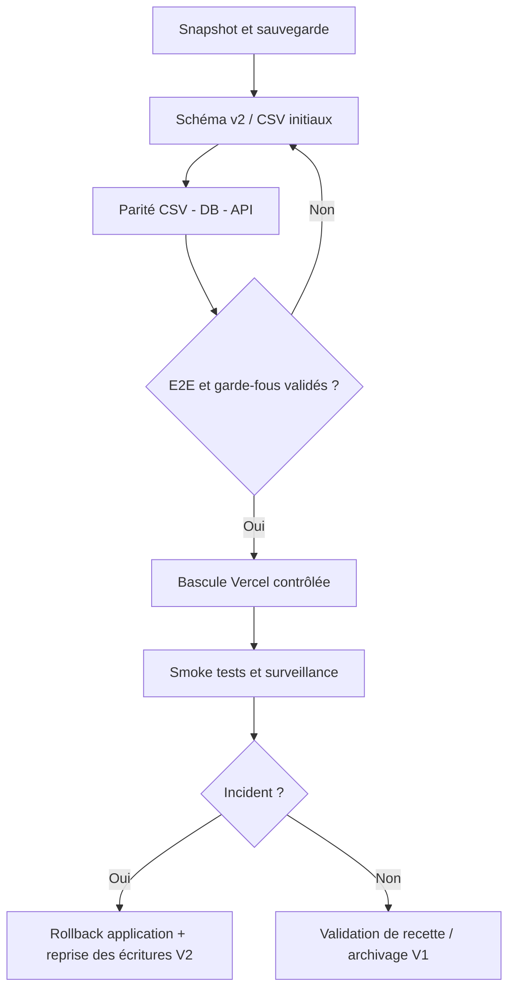

# Runbook d'initialisation et de bascule V2

## État réel connu

Le schéma `v2` existe en production Neon, issu des migrations 001 à 005 ; 27 postes et un jeu de paramètres sont présents. Lors du dernier contrôle, budgets, propositions, impacts et votes **V2 étaient vides**. Le schéma `public` demeure en place et une branche de sauvegarde `backup-pre-v2-cutover-20261122` a été créée.

Le frontend V2 existe sur la PR #142, non fusionnée ; aucune bascule de trafic n'est attestée.

## Ordre actuel des migrations

1. [001_schema.sql](../../db/v2/001_schema.sql) — tables, FK, import transactionnel.
2. [002_seed_reference.sql](../../db/v2/002_seed_reference.sql) — copie des catégories V1 vers V2.
3. [003_citizen_crud.sql](../../db/v2/003_citizen_crud.sql) — publication, révision, retrait et jetons.
4. [004_votes.sql](../../db/v2/004_votes.sql) — votes anonymes et identifiants historiques.
5. [005_ui_contract.sql](../../db/v2/005_ui_contract.sql) — paramètres et métadonnées de présentation.

**Migrations historiques 002 et 005 :** elles lisent encore `public` et restent conservées pour mémoire. La nouvelle commande `db:init` utilise le snapshot versionné `data/reference/2025-v2.json` et `db/v2/initial_ui.sql`, sans dépendance aux tables V1. Elle n'a pas encore été éprouvée sur une branche Neon vierge ; ne pas supprimer les migrations historiques avant recette.

## Commandes de test existantes

```bash
npm install
npm run check
npm test
npm run test:v2
npm run audit:editorial:v2
npm run build
node scripts/v2/import.mjs --all
# Après validation sur une branche Neon QA uniquement :
# V2_DATABASE_URL=... node scripts/v2/import.mjs --all --apply
```

## Procédure de cutover



NoPasaran doit être réimporté depuis ses **CSV 8 propositions / 8 impacts**. Les contributions et votes V1 actuels sont des tests jetables, non migrés. En revanche, **toutes les contributions V2 créées après la bascule deviennent des données à préserver** : un simple rollback d'alias ne suffit plus.

## Gates indispensables

- NoPasaran et tous les programmes politiques repris depuis les CSV.
- Impacts #145 intégrés dans le code V2 ; vérifier en QA leur parité effective : LFI 28 sources / 11 propositions / 11 allocations sans double compte.
- Tests API et navigateur complets : lecture, publication, vote, lien, projection, mobile.
- Reproductibilité de l'initialisation sur une base réellement vierge, sans dépendance cachée à `public`.
- Stratégie de droits SQL (rôle applicatif séparé du rôle import), rollback documenté.
- SHA Git, version des CSV, branche Neon et URL preview notés dans le rapport de recette.

**Nettoyage V1 : seulement après validation des tests utilisateurs**. Les commandes `db:init`, `db:import` et `db:check` sont maintenant présentes, non destructives par défaut et couvertes par la CI. Tester le bootstrap sur branche vierge, puis archiver et retirer les migrations V1 devenues obsolètes.
