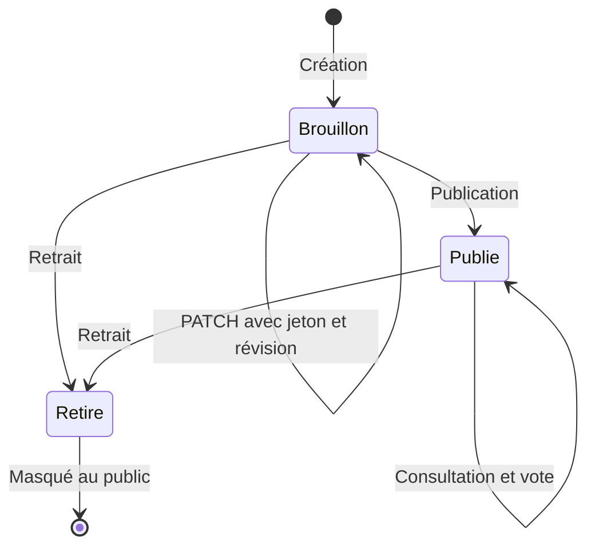

# Parcours fonctionnels V2

## Les quatre parcours

| Parcours | Résultat attendu |
|---|---|
| Comprendre | Référence 2025, 27 postes, descriptions, hypothèses de simulation |
| Comparer | Écarts de deux budgets, postes et trajectoires comparables |
| Mon budget | Création / reprise de scénario, impacts, sauvegarde, publication |
| Voter | Présentation des budgets publiés, propositions consultables, vote et partage |

## Cycle de vie citoyen

La publication est définitive. Le vote anonyme est dédupliqué par navigateur, pas par personne. Un budget politique ne peut pas être publié/modifié par l'API citoyenne.

## Trois niveaux à distinguer sur l'UI

1. Présentation politique et documents de programme ;
2. Propositions et **montants annoncés** sourcés ;
3. **Impacts réellement appliqués**, uniquement lorsque qualifiés.

Pour le cas LFI 2027, le compteur doit indiquer 11 propositions issues de 28 mesures du programme ; les montants non ventilables restent documentaires.

## Critères de recette

Comparer les jauges et les soldes NoPasaran, un budget PARTIAL et un AGGREGATE. Tester la création, modification de brouillon, publication, impossibilité de modification d'un publié, retrait, vote double, partage et écran mobile. Tester l'absence de double comptage LFI. Ces tests E2E restent requis avant le cutover.

## Sélection de Comparer et publication

La comparaison contient toujours la référence INSEE et tous les programmes politiques publics. Les budgets citoyens ne sont proposés que si leur champ `featured` vaut `true`, attribué par PostgreSQL au budget citoyen publié classé par votes décroissants, puis nombre de propositions décroissant, puis date de publication décroissante (dates nulles en dernier), et UUID pour départage stable. Le badge « champion citoyen » ne crée pas d'exception de sélection. Une publication est refusée si 100 budgets citoyens sont déjà publiés ; aucun compteur glissant de 24 heures ne s'applique.
