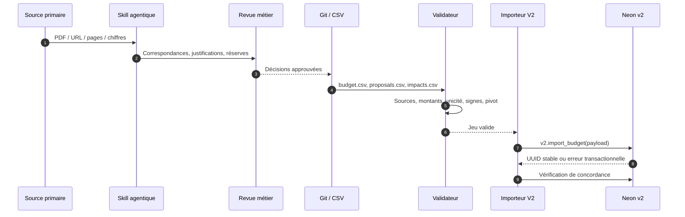
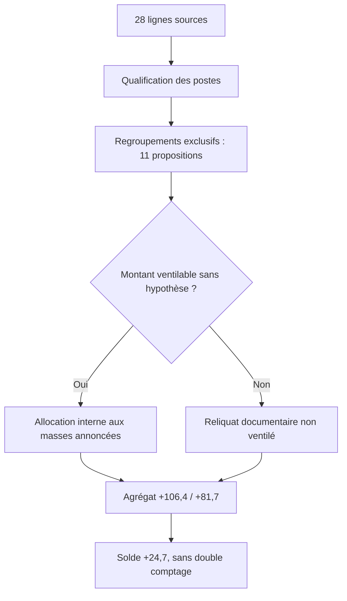

# Intégration et qualification des programmes

## Source de vérité

- `budget.csv` : identité/version, présentation, documents et agrégats annoncés.
- `proposals.csv` : titre, description, montant revendiqué, statut, URL, année.
- `impacts.csv` : poste citoyen et variation signée *validée* ; un seul impact par budget/côté/poste.
- `scripts/v2/import.mjs` : validation et persistance sans raisonnement agentique.
- `skills/budget-impact-qualification/SKILL.md` : méthode d'analyse des sources et de décision.

## Exigences LFI de la PR #145

L'importeur V2 ne sait pas encore recevoir les fichiers `groupes-citoyens.csv` / `rattachements-citoyens.csv` / `impacts-citoyens.csv` de #145 dans une représentation canonique conservant toutes les sources **et** l'effet AGGREGATE. Il faut adapter le pipeline et tester le calcul avant le cutover. Les revendications ne doivent jamais être dupliquées dans `budget_proposal_impacts` comme deltas additionnels.

## Vérification d'un import

1. Sources CSV distinctes = sources importées, à exclusion documentée près.
2. Aucun poste du même budget attribué deux fois.
3. Allocations + reliquats = montants revendiqués (par côté).
4. Deux exécutions du même import donnent le même résultat logique.
5. L'API et l'UI affichent le même inventaire que la base.
6. Les contributions citoyennes postérieures à la bascule ne sont jamais écrasées par le seed.
