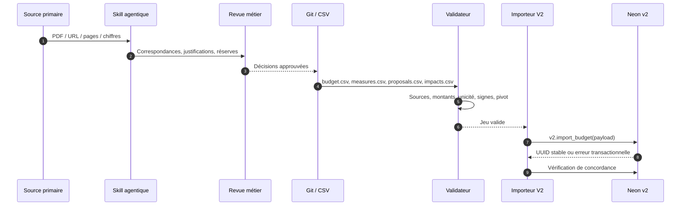
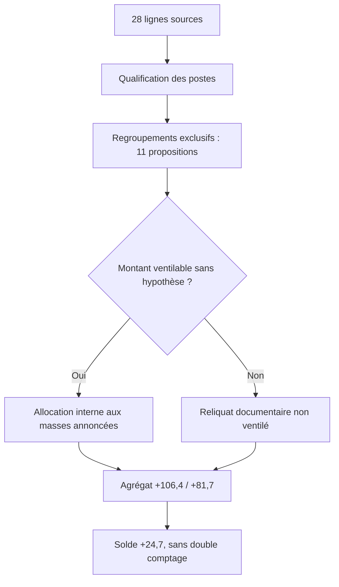

# Intégration et qualification des programmes

## Source de vérité

- `budget.csv` : identité/version, présentation, documents et agrégats annoncés.
- `measures.csv` : mesures extraites, `measure_key`, `proposal_key`, sources, statuts et montants revendiqués éventuels.\n- `proposals.csv` : regroupements avec `proposal_key`, titre et description ; zéro mesure source possible pour une proposition citoyenne directe.
- `impacts.csv` : `proposal_key`, poste citoyen et variation signée *validée* ; un seul impact par budget/côté/poste.
- `scripts/v2/import.mjs` : validation et persistance sans raisonnement agentique.
- `skills/budget-impact-qualification/SKILL.md` : méthode d'analyse des sources et de décision.

## Exigences LFI de la PR #145

Le pipeline de qualification V2 peut aussi lire les fichiers `groupes-citoyens.csv`, `rattachements-citoyens.csv` et `impacts-citoyens.csv` de #145 ; il conserve les sources, 11 regroupements et allocations internes aux agrégats dans `documentary`. La CI vérifie les montants et les compteurs ; la parité Neon QA → API → UI reste à démontrer avant le cutover. Les revendications ne doivent jamais être dupliquées dans `budget_impacts` comme deltas additionnels.

## Vérification d'un import

1. Mesures sources distinctes = mesures importées, à exclusion documentée près.
2. Aucun poste du même budget attribué deux fois.
3. Allocations + reliquats = montants revendiqués (par côté).
4. Deux exécutions du même import donnent le même résultat logique.
5. L'API et l'UI affichent le même inventaire que la base.
6. Les contributions citoyennes postérieures à la bascule ne sont jamais écrasées par le seed.
