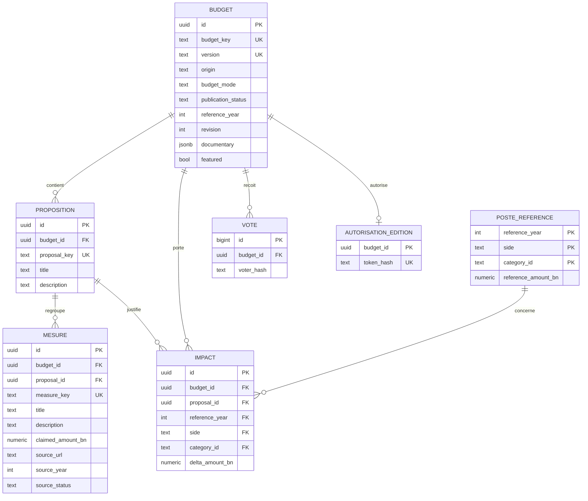

# MCD et schéma logique V2

**Source physique :** [DDL canonique](../../db/v2/001_schema.sql), [publication](../../db/v2/003_citizen_crud.sql), [votes](../../db/v2/004_votes.sql), [règle featured](../../db/v2/007_citizen_featured.sql).

## Cardinalités et invariants

- **Budget → Proposition :** un budget contient zéro à N propositions ; chaque proposition appartient à un budget.
- **Proposition → Mesure :** zéro à N mesures extraites ; une mesure appartient exactement à une proposition consolidée. Une proposition citoyenne directe peut n'avoir aucune mesure source.
- **Proposition → Impact :** zéro à N impacts qualifiés, éventuellement répartis sur plusieurs postes ; une mesure source ne crée jamais directement une écriture dans la table d'impacts.
- **Exclusivité comptable :** `UNIQUE(budget_id, side, category_id)` sur `v2.budget_impacts` garantit un seul impact par poste citoyen et par budget.
- **Concordance d'identité :** la FK composite `(proposal_id, budget_id)` interdit de rattacher une mesure ou un impact à une proposition d'un autre budget.
- **Montants :** `budget_measures.claimed_amount_bn` = montant annoncé dans le programme ; `budget_impacts.delta_amount_bn` = variation qualifiée, jamais une simple copie automatique.
- **AGGREGATE :** les `claimedAllocations` documentaires ventilent *en interne* les agrégats annoncés ; elles ne constituent pas des deltas supplémentaires.
- **Publication :** `v2.latest_budgets` expose uniquement la version `latest` publiée ; les triggers calculent le `featured` citoyen d'après les votes.

## Tables canoniques

| Table | Clé ou contrainte |
|---|---|
| `v2.budgets` | `UNIQUE(budget_key, version)` |
| `v2.budget_proposals` | `UNIQUE(budget_id, proposal_key)` |
| `v2.budget_measures` | `UNIQUE(budget_id, measure_key)` et FK composite vers la proposition |
| `v2.budget_impacts` | FK composite et `UNIQUE(budget_id, side, category_id)` |
| `v2.reference_posts` | `PRIMARY KEY(reference_year, side, category_id)` |

Voir également [le contrat CSV](integration.md) et [les règles de domaine](metier.md).
