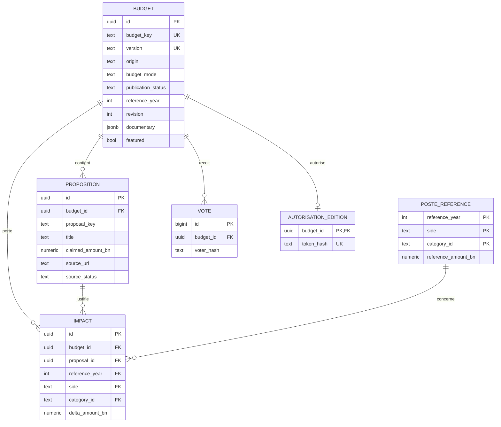

# MCD et schéma logique V2

**Référence physique :** [SQL 001](../../db/v2/001_schema.sql), [003](../../db/v2/003_citizen_crud.sql), [004](../../db/v2/004_votes.sql), [005](../../db/v2/005_ui_contract.sql).

## Invariants physiques

| Table | Contrainte importante |
|---|---|
| `v2.budgets` | PK UUID ; UNIQUE (`budget_key`, `version`), `origin` citoyen/parti/pédagogique |
| `v2.budget_proposals` | UNIQUE (`budget_id`, `proposal_key`), FK budget |
| `v2.budget_proposal_impacts` | FK composites vers budget/proposition/poste ; UNIQUE (`budget_id`, `side`, `category_id`) ; montant non nul |
| `v2.reference_posts` | PK (`reference_year`, `side`, `category_id`) |
| `v2.reference_parameters` | Paramètres de simulation indexés par année |
| `v2.citizen_edit_grants` | Token haché, clé sur le budget |
| `v2.votes` | Unicité (`budget_id`, `voter_hash`) |

La vue `v2.latest_budgets` filtre la version `latest` et l'état `published`.

**Intégration #145 dans la V2 :** les groupes documentaires, lignes sources et allocations internes sont actuellement conservés en `v2.budgets.documentary` (JSONB structuré, validé à l'import), **pas** dans `v2.budget_proposal_impacts`. Ce choix évite les impacts additionnels, mais pourra être normalisé en tables relationnelles lorsque les besoins de requêtage le justifient.
