# Skill V2 — qualification et amélioration éditoriale

## Choix du mode

- **`FULL_QUALIFICATION`** (défaut) : suivre la chaîne Mesure → Proposition → Impact ci-dessous. Peut produire les quatre CSV après revue métier.
- **`EDITORIAL_UPGRADE`** : utiliser exclusivement le protocole dédié en fin de ce document. Il ne crée ni nouvelle mesure/proposition ni nouvel impact. Il travaille uniquement sur les descriptions déjà présentes et produit un diff éditorial soumis à validation.

Ne **jamais** lancer les étapes de chiffrage, regroupement, estimation ou validation budgétaire du mode complet lorsque `EDITORIAL_UPGRADE` est demandé.

## Chaîne de qualification — `FULL_QUALIFICATION`

## Concepts canoniques

- **Mesure :** engagement élémentaire extrait fidèlement d'un programme politique, identifié par `measure_key`, traçable à une source primaire. Le montant `claimed_amount_bn` est *revendiqué*, pas automatiquement imputable.
- **Proposition :** unité consolidée, identifiée par `proposal_key`, regroupant une ou plusieurs mesures sources par lien explicite. Le citoyen peut créer directement une proposition sans mesures extraites (0 mesure).
- **Impact :** variation budgétaire justifiée sur un poste de référence ; il est rattaché à une proposition et non directement à une mesure. Un seul impact par `(budget_key,side,category_id)`.

Références impératives : `docs/v2/metier.md`, `docs/v2/mcd.md`, `docs/v2/integration.md`, `db/v2/001_schema.sql`, `scripts/v2/import.mjs`, référentiel de l'année, sources primaires des mesures.

## Pipeline

```mermaid
flowchart LR
    A["PDF / URL primaire"] --> B["Extraction agentique des mesures"]
    B --> C["measures.csv : source, millésime, montant revendiqué"]
    C --> D["Qualification des lignes du pivot"]
    D --> E["Regroupement agentique en propositions"]
    E --> F["proposals.csv + impacts.csv"]
    F --> G["Revue humaine"]
    G --> H["Validation déterministe : clés, montants, exclusivité"]
    H --> I["Import SQL transactionnel"]
```



**L'agent n'écrit ni en base, ni dans le moteur de calcul, ni dans les droits de publication.** L'extraction et le rapprochement documentaire sont agentiques ; le contrôle des références, la construction du contrat, les additions et l'import sont déterministes. La revue métier confirme les hypothèses retenues.

## Étape 1 — Extraire les mesures

Pour chaque mesure, conserver au minimum :
- `budget_key,measure_key,title,description,source_url,source_year` ;
- `source_section,source_excerpt,source_status,source_origin,notes` si disponibles ;
- `claimed_amount_bn,direction,amount_unit` si le chiffrage est expressément documenté.

Ne jamais mélanger deux millésimes LFI, supposer un montant manquant ou remplacer la source primaire par une inférence non sourcée. Les mesures non chiffrées sont conservées.

## Étape 2 — Regrouper les mesures en propositions

Identifier les postes citoyens potentiellement concernés sur la base d'une justification vérifiable. Former les groupes exclusifs selon les composantes connexes du graphe **mesures ↔ postes** : si plusieurs mesures concernent le même poste, elles appartiennent à une même proposition. Si une mesure touche deux postes, les composantes correspondantes fusionnent transitivement.

Chaque mesure extraite appartient exactement à **une** proposition, matérialisée dans `measures.csv` par `proposal_key`. Pour un groupe, fournir dans `proposals.csv` :
`budget_key,proposal_key,title,description`.

Garder aussi les engagements non imputables : une proposition peut n'avoir aucun impact. Une proposition citoyenne saisie directement n'a pas de mesure source fictive.

## Étape 3 — Qualifier les impacts

Pour chaque proposition, documenter dans un **registre de revue**, distinct des CSV importables :
- ses `measure_key` membres et les preuves de provenance ;
- `classification_status` : `direct_candidate`, `split_required`, `overlap_risk`, `year_uncertain`, `out_of_scope`, `insufficient_evidence` ;
- pour chaque impact candidat : `side,category_id,delta_amount_bn`, source/page, calcul exact, signe, justification et incertitude ;
- les chevauchements avec d'autres mesures, propositions, agrégats et écritures.

**Ne produire `impacts.csv` que pour les montants justifiables.** Format : `budget_key,proposal_key,side,category_id,delta_amount_bn` en Md€ avec un signe explicite. Une même proposition peut couvrir plusieurs postes ; un poste ne peut figurer dans deux propositions du même budget. Aucune clé `measure_key` n'identifie un impact.

En `PARTIAL`, seuls les impacts retenus modifient la simulation. En `AGGREGATE`, les masses annoncées sont autoritaires : les ventilations documentaires (`claimedAllocations`) sont **internes** et non des deltas additionnels. Conserver tout reliquat sans répartition arbitraire. Ne pas confondre les dispositifs hors budget et les recettes APU.

## Étape 4 — Valider et exporter

Fichiers canoniques communs à toutes les origines :
1. `budget.csv` — identité du budget, millésime, mode et métadonnées.
2. `measures.csv` — mesures sources (en-tête seul pour les propositions citoyennes directes).
3. `proposals.csv` — regroupements, dont ceux de cardinalité 0 mesure.
4. `impacts.csv` — affectations signées qualifiées et exclusives.

Les fichiers complémentaires LFI `groupes-citoyens.csv`, `rattachements-citoyens.csv` et `impacts-citoyens.csv` peuvent conserver la traçabilité détaillée et les ventilations internes ; ils doivent être **cohérents** avec les quatre CSV canoniques, sans devenir une deuxième source d'impacts comptables.

Exécuter `npm run test:v2` et `npm run db:check`. En QA : création complète avec `db:init`, import avec `db:import` puis `db:check -- --live`. Vérifier l'idempotence et les compteurs source/proposition/impact, sans invention de montants.

## Jeux de référence à ne pas dégrader

- **LFI 2027 :** 28 mesures sources → 11 propositions consolidées ; 11 allocations documentaires activées sur 15 postes ; 5 impacts explicites CSV seulement, non additionnés à l'AGGREGATE. Le poste Éducation regroupe les mesures `src-19`, `src-20`, `src-21` ; la seule écriture CSV du poste reste `4.000` Md€ issue des deux mesures qualifiées `src-19` et `src-21`.
- **NoPasaran :** huit propositions créées directement, zéro mesure extraite, huit impacts ; le poste défense conserve un impact consolidé de −25 Md€.

Une qualification `validated` ne peut jamais être déduite du seul fait qu'une mesure est numériquement chiffrée. Conserver et expliquer les inconnues et réserves.

## Mode `EDITORIAL_UPGRADE` — enrichissement qualitatif sans mutation financière (#157)

### Mission et périmètre

Améliorer la **présentation générale d'un programme existant** et, quand les sources sont suffisantes, les **titres/descriptions de ses propositions existantes**. L'objectif est une rédaction accessible, fidèle et neutre, pas une nouvelle extraction, une reclassification, un calcul ou une validation financière.

Ce mode prépare les données pour **#156**. Il n'écrit pas dans Neon ; il ne publie pas de contenus, ne fusionne pas de PR et ne déclenche aucun `db:init`.

### Entrées obligatoires

1. Identifier le **dossier de programme et le millésime** : `data/programmes/<formation>/<année>/`, `budget_key` et `version` existants. La sélection d'un sous-ensemble de propositions par `proposal_key` est autorisée.
2. Lire `budget.csv`, `proposals.csv`, `measures.csv`, `impacts.csv`, `documentary_json.sources` et, s'ils existent, `presentation.csv`, `documentary_json.background_text`, les fichiers de thèmes et les annexes. Vérifier les **sources primaires du bon millésime**, pas uniquement les titres.
3. Relier chaque proposition à ses mesures sources par `proposal_key`; utiliser les `source_url`, `source_section`, `source_excerpt` et `source_status` déjà collectés. Pour un programme sans mesures, travailler uniquement avec le contenu effectivement sourcé disponible. **Source insuffisante = signaler l'impossibilité d'enrichir**, pas inventer.

### Doctrine de rédaction

- **Présentation du budget** : quelques phrases fluides présentant les priorités réellement documentées, le porteur du programme et le millésime. Éviter les listes brutes, les URL répétées et les affirmations trop générales. Une couverture documentaire partielle doit être rendue explicite.
- **Proposition** : expliquer l'action concrète, son objectif et sa cible **uniquement si le document le permet**. Conserver le sens politique original sans plaidoyer, critique, jugement de valeur ni promesse inventée. Maintenir les distinctions annonce / justification / preuve.
- **Montants** : si leur mention est indispensable à l'intelligibilité d'une phrase, citer fidèlement la source, mais **ne jamais modifier les montants structurés** ni déduire de nouveaux impacts, même si un montant apparaît dans un titre.
- **Sources et traçabilité** : conserver les références dans les champs de provenance existants ; indiquer dans le registre de revue le(s) document(s), la section et les réserves. La rédaction ne doit jamais faire passer une inférence pour un fait confirmé.
- **Qualité homogène, profondeur proportionnée** : appliquer une exigence commune de neutralité et lisibilité, mais ne pas inventer artificiellement du contenu pour égaler la longueur de LFI.

### Champs modifiables — liste fermée

- `budget.csv` : **`description` uniquement**.
- `proposals.csv` : **`title` et `description` uniquement**, en préservant l'ordre et les `proposal_key`.
- `budget.csv.documentary_json.background_text` : synchronisation de la présentation lorsqu'elle duplique le texte principal. Tous les autres champs de `documentary_json` sont intouchables.
- `presentation.csv.description` si le fichier existe : synchroniser avec `budget.csv.description` car l'importeur V2 utilise `presentation.csv` pour renseigner la description en base.

**Tout autre champ et fichier est immuable** : identifiants, `version`, millésime, origine, mode `PARTIAL/AGGREGATE`, mesures, liens, `impacts.csv`, sources, statuts de qualification, montants revendiqués, agrégats et ventilations, catégories budgétaires, votes et contributions. Aucun nouveau poste, nouvelle mesure ou proposition. **Ne pas toucher à NoPasaran**, budget citoyen de référence, dans la campagne sur les programmes politiques.

### Procédure en deux phases

**1. Préparer — agentique, sans écriture en base**

1. Conserver un **instantané avant** du dossier CSV en entrée ; traiter un programme à la fois et ne modifier que les champs autorisés.
2. Préparer pour revue un registre par `budget_key` / `proposal_key` contenant **ancien texte**, **nouveau texte**, **source(s) et section(s)**, justification, statut `accepted | needs_review | insufficient_source`. Proposer les textes sans publier automatiquement.
3. En cas de source insuffisante, laisser le contenu existant inchangé et inscrire une réserve ; ne pas produire une formulation spéculative.

**2. Vérifier — déterministe, avant toute PR ou import**

Exécuter, pour **chaque dossier modifié** :

```bash
node scripts/v2/editorial-upgrade.mjs <dossier-avant> <dossier-apres>
npm run db:import
npm run test:v2
npm run db:check
```

Le validateur `editorial-upgrade.mjs` compare les lots tels que l'importeur les lit, contrôle l'inventaire des fichiers, exige la conservation **octet pour octet** de `measures.csv` et `impacts.csv`, interdit toute modification non éditoriale et vérifie la cohérence de `presentation.csv` avec la description canonique. Une différence interdite **bloque la suite** ; pas d'exception pour « simplifier » les données.

L'agent n'a pas le droit d'utiliser le mode complet pour contourner ce blocage. La validation éditoriale des nouveaux textes reste une décision de revue humaine.

**Application en base : uniquement dans #156**, après revue et tests QA, avec `npm run db:import -- --apply` sur la cible explicite, puis `npm run db:check -- --live`. L'importeur réapplique les lots complets : comparer avant/après les identifiants, votes, contributions, impacts et autres champs protégés. **Aucun reset, aucun `--force`, aucune migration.**

### Cas de recette attendus

- **LFI 2027** : programme riche, cohérence `budget.csv` / `presentation.csv` et sources, sans toucher aux 28 mesures et 11 propositions.
- **ECO 2027** : transformer l'énumération brute de mesures en présentation lisible, sans promettre une analyse exhaustive si l'inventaire est partiel.
- **RN 2026** : étoffer les descriptions vides lorsque les mesures et sources le permettent ; conserver les 78 propositions et leur identité.
- **Budget sans propositions** : présenter honnêtement les sources disponibles sans créer de ligne.
- **NoPasaran** : aucune modification dans la campagne éditoriale des budgets politiques.
- Tests négatifs : refuser changement de montant, de clé, de référence documentaire, de regroupement, de mesure, d'impact, de mode ou de nombre de lignes.

Le mode est opérationnel lorsque les textes passent la revue éditoriale **et** que le diff non éditorial est rigoureusement nul.
